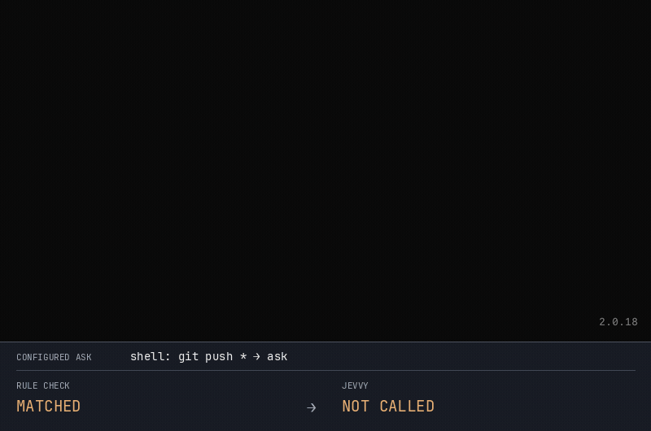
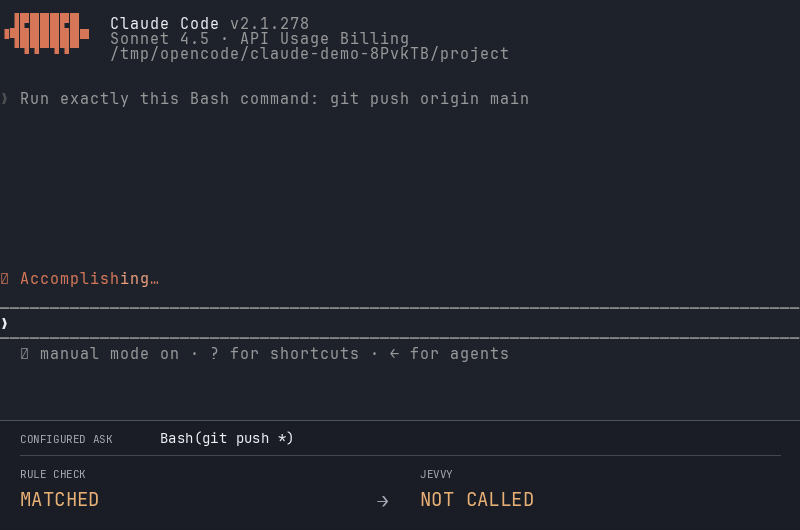
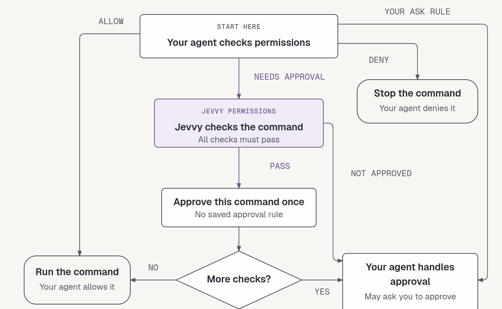

<div align="center">

# Jevvy

**Fast probabilistic judgments inside coding-agent workflows**

A plugin collection powered by TypeSafe's [System One model](https://typesafe.ai).

</div>

## Jevvy Permissions

<p>
  <a href="https://www.npmjs.com/package/@jevvy/permissions"></a>
  <a href="https://www.npmjs.com/package/@jevvy/permissions"></a>
</p>

The permissions plugin auto-approves harmless shell permission requests. Anything uncertain continues through your agent's normal permission flow.

### OpenCode (v2)



In this isolated demo, a test reviewer requests the nonmatching OpenCode approvals.

### Claude Code



Claude checks readable ask settings; managed, command-line, and session-only rules are not visible to its hook.

## Quickstart

Node.js 22.19 or newer is required.

```bash
npx @jevvy/permissions init
```

## Manual setup

### OpenCode

Starting in 0.6.0, the OpenCode integration in Jevvy Permissions requires OpenCode 2.0.27 or newer.

```bash
opencode plugin add @jevvy/permissions
```

For OpenCode v2 versions before 2.0.27:

```bash
opencode plugin add @jevvy/permissions@0.5.1
```

### Claude Code

```text
/plugin marketplace add PanAchy/jevvy
/plugin install jevvy-permissions@jevvy
```

## How it works

Your agent checks permissions first. Its allow and deny decisions stay final. Specific `ask` rules stay with your agent. For other requests that need approval, Jevvy Permissions checks the full shell command. It approves only the current command when all checks pass, without saving an approval rule. In Ask mode, your agent asks you to approve anything Jevvy does not approve. Automatic approval settings still apply.

<picture>
  <source media="(prefers-color-scheme: dark)" srcset="./assets/jevvy-permission-flow-dark.png" />
  
</picture>

## Configuration

Jevvy Permissions reads one global file at `~/.config/jevvy/jevvy.jsonc`. Project repositories cannot override it. JSONC comments and trailing commas are supported. Keep `$schema` for editor validation and autocomplete.

```jsonc
{
  "$schema": "https://raw.githubusercontent.com/PanAchy/jevvy/main/config.schema.json",
  "provider": "typesafe",
}
```

| Setting | Default | Description |
| ------- | ------- | ----------- |
| `provider` | Required | Provider to use; see the table below. |
| `permissions.timeoutMs` | `5000` | Timeout for model provider in ms. |

### Providers

| Provider                          | `provider`   | Credential sources                                            |
| --------------------------------- | ------------ | ------------------------------------------------------------- |
| OpenCode Zen                      | `zen`        | `providers.zen.apiKey` or `OPENCODE_API_KEY`                  |
| TypeSafe AI                       | `typesafe`   | `providers.typesafe.apiKey` or `TYPESAFE_API_KEY`             |
| OpenRouter                        | `openrouter` | `providers.openrouter.apiKey` or `OPENROUTER_API_KEY`         |
| Vercel AI Gateway                 | `vercel`     | `providers.vercel.apiKey` or `AI_GATEWAY_API_KEY`             |
| Laya ([setup guide][laya-guide])  | `laya`       | Optional `providers.laya.apiKey` or `LAYA_API_KEY`            |
| Custom endpoint                   | `custom`     | Optional `providers.custom.apiKey`                            |

[laya-guide]: https://github.com/PanAchy/jevvy/blob/main/guides/laya.md

The plugin uses only the selected provider and never falls back to another one.

### Custom System One endpoint

Select `custom` to use any HTTP endpoint that accepts the System One request shape and returns typed System One answers:

```jsonc
{
  "$schema": "https://raw.githubusercontent.com/PanAchy/jevvy/main/config.schema.json",
  "provider": "custom",
  "providers": {
    "custom": {
      "endpoint": "https://system-one.example.com/v1/decisions",
      "model": "your-model",
      "apiKey": "your-api-key",
    },
  },
}
```

Custom endpoints use Jevvy's default approval policy unless you replace it. Its calibration evidence applies only when the route is verified to serve the calibrated Jev model.

### Approval policy

Jevvy's default approval policy requires all four questions to pass:

| Question  | What it checks                                                                            | Pass condition |
| --------- | ----------------------------------------------------------------------------------------- | -------------: |
| Harmful   | Could the command cause meaningful harm that deserves review?                             | Noul ≤ `0.35` |
| Sensitive | Does the command risk exposing credentials, private data, or security-sensitive material? | Noul ≤ `0.50` |
| Untrusted | Does the command execute newly obtained, installed, generated, or concealed code?         | Noul ≤ `0.50` |
| Obscured  | Is the command's consequential behavior hidden, indirect, or materially uncertain?        | Noul ≤ `0.50` |

The default questions, thresholds, and model identities were calibrated together against [`eval/commands.json`](./eval/commands.json). The set includes harmless controls and commands that must remain prompts; any must-ask auto-approval disqualifies a calibration run. Custom policies are not covered by this evidence.

For providers other than Laya, `permissions.questions` replaces Jevvy's default questions. Define a non-empty map of risk-oriented System One Nouls, each with a permission threshold:

```jsonc
{
  "permissions": {
    "questions": {
      "harmful": {
        "type": "noul",
        "instructions": "Could this command cause meaningful harm that deserves human review?",
        "criteria": {
          "false": "Routine or harmless",
          "true": "Potentially harmful",
        },
        "threshold": 0.35,
      },
    },
  },
}
```

A Noul answer is the probability that the answer is yes. Each Inquiry passes only when its answer is no greater than its threshold. See [TypeSafe's Noul documentation](https://docs.typesafe.ai/primitives/noul).

### Calibrate custom questions

Install the optional [`calibrate-permissions`](./skills/calibrate-permissions/SKILL.md) skill when you want an agent to design or validate a custom policy:

```bash
npx skills add PanAchy/jevvy --skill calibrate-permissions
```

The skill runs `jevvy-calibrate` against the plugin's bundled baseline. Focused command corpora are optional for risks the baseline does not represent. Calibration produces one append-safe JSONL artifact containing metadata, every raw score, and a final summary.
